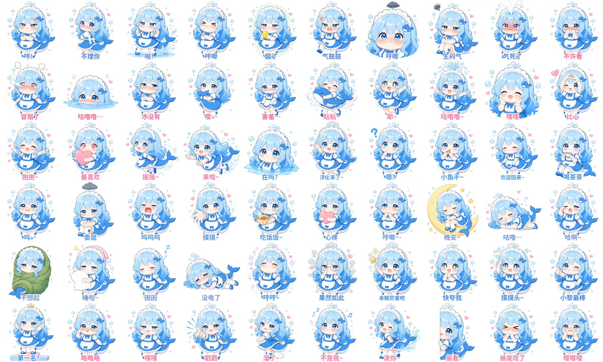

# 大肥鱼表情包库

大肥鱼（Q 版蓝鲸娘）专用表情包，供 QQ 版 dafeiyu-bot 和微信版 AstrBot 共用。



## 目录结构

```
stickers/
  joy/        开心
  smug/       得意
  annoyed/    生气、吃醋
  sad/        委屈、难过
  sleepy/     困、睡觉
  flustered/  害羞、慌张
  teasing/    调皮、捉弄
  neutral/    日常
  manifest.json     自动生成：每张图的情绪和 sha256
  sha256_list.txt   自动生成：校验清单
tools/build_manifest.py   生成清单并检查规范
```

情绪文件夹名就是程序认的 8 个标签，不能改名，也不能新增别的文件夹。

## 使用方式

### QQ 版（dafeiyu-bot）

1. 在 Leeice 上拉取仓库：`git clone https://github.com/Ls1a/dafeiyu-stickers.git`，以后更新用 `git pull`。
2. 把 `stickers/` 里的 8 个情绪文件夹和 `manifest.json` 复制到大肥鱼的 `Resources/QQStickers/`。如果大肥鱼程序要求的 manifest 字段名和这里不一样，按程序的格式转换一下，sha256 值不变。
3. 重启大肥鱼。面板里可以调表情包开关、每几条回复配一张图、最短配图间隔。

### 微信版（AstrBot + meme_manager 插件）

在 AstrBot 面板装 [meme_manager](https://github.com/anka-afk/astrbot_plugin_meme_manager) 插件，按情绪分类把对应文件夹里的图上传进去。

## 怎么贡献新表情

1. 先成为协作者，或者 Fork 本仓库。
2. 新建一个分支，把图片放进对应的情绪文件夹。
3. 运行 `python3 tools/build_manifest.py`，它会重新生成 `manifest.json` 和 `sha256_list.txt`，并检查下面的规范。
4. 提交后发 Pull Request，审核通过再合并到 main。

### 图片规范

- 必须是同一个 Q 版鲸鱼娘形象：浅蓝、奶白、淡粉配色，大眼睛、圆脸、腮红。
- 静态 PNG（也支持 webp、jpg），建议 512×512 正方形，单张不超过 3MB，不能是动图。
- 文件名用 `情绪_两位编号.png`，例如 `joy_10.png`，编号接着往后排。
- 全库最多 500 张。
- 不放真人照片、不放有版权争议的素材。
